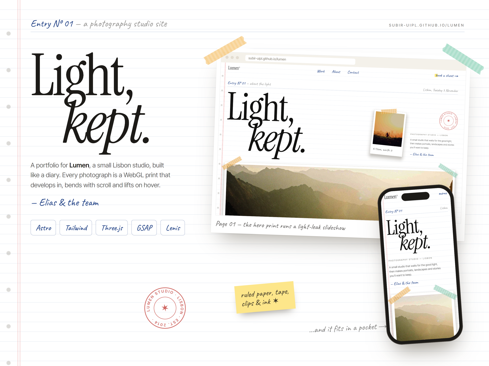
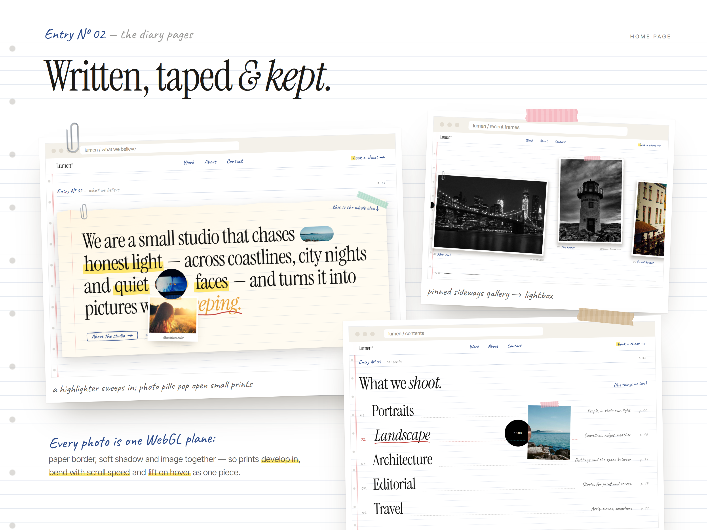
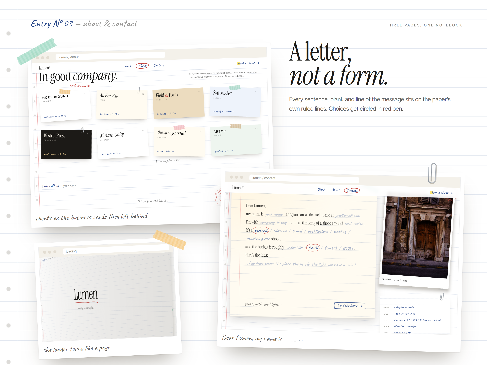
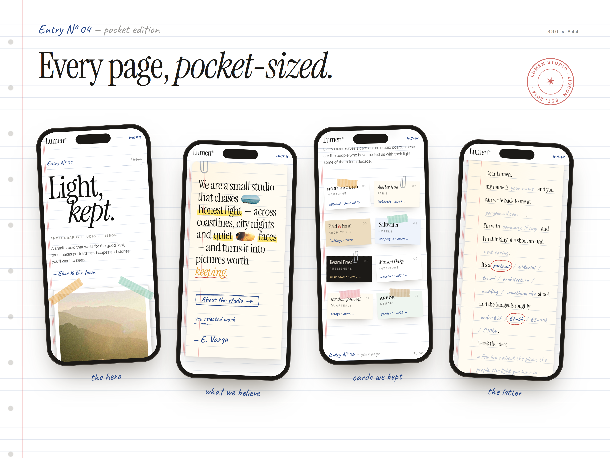

# Lumen — Light, kept.

A white, modern portfolio site for **Lumen**, a concept photography studio in Lisbon. It's built like a diary: ruled pages, handwritten notes, washi tape, paper clips and ink stamps, with every photograph mounted as a print. The prints are drawn in WebGL, so they develop in, bend with scroll speed and lift towards you on hover, border and shadow included.

<p align="center">
  <a href="https://subir-uipl.github.io/lumen/"></a>
</p>

<p align="center">
  <strong><a href="https://subir-uipl.github.io/lumen/">▶ Open the live site</a></strong> · scroll quickly to see the prints bend, and hover the photos
</p>

[](https://subir-uipl.github.io/lumen/)

## Highlights

- **A diary, page by page.** Each section is a dated entry on white ruled paper, with punched holes, a red margin and a handwritten nav where the current page is circled in red pen.
- **Prints in WebGL.** One Three.js canvas draws every photo together with its paper border and soft shadow. Prints develop in from white, bend and split their colours with scroll speed, and lift on hover. The hero print runs a slideshow with a light-leak wipe and a light that follows the pointer.
- **The page turns.** The loading screen is a diary page that swings open on its spine, then swings back shut between pages.
- **Recent frames.** A pinned, sideways-scrolling gallery of tilted, taped prints that open in a lightbox.
- **Contents page.** The services read like a diary's contents, with dotted leaders and a red pen underline; a taped print follows the pointer along the list.
- **Handwritten details.** A highlighter sweeps across key words as you scroll, photo pills open small prints, stats count up, and buttons are boxes sketched in ink.
- **About.** Taped prints for the method and the people, and the clients as a board of business cards, each in its own house style.
- **Contact as a letter.** The form is a note you fill in: every line of text, every blank and the message sit on the paper's own ruled lines, and your choices are circled in pen.
- **A leather back cover** for the footer, with stitching, a ribbon bookmark and a debossed wordmark.
- **Responsive.** Every page restacks for phones, and the custom lens cursor only appears with a mouse.

## Screenshots

| | |
|---|---|
|  |  |
|  | |

## Built with

- [Astro](https://astro.build/) — pages, components and a static build
- [Tailwind CSS 4](https://tailwindcss.com/)
- [Three.js](https://threejs.org/) — the WebGL prints and their shaders
- [GSAP](https://gsap.com/) + ScrollTrigger — reveals, the pinned gallery and the page turn
- [Lenis](https://lenis.darkroom.engineering/) — smooth scrolling
- Fonts: [Instrument Serif](https://fonts.google.com/specimen/Instrument+Serif), [Inter Tight](https://fonts.google.com/specimen/Inter+Tight) and [Caveat](https://fonts.google.com/specimen/Caveat) for the handwriting
- Photos from [Lorem Picsum](https://picsum.photos/) (Unsplash)

## Run locally

Requires Node.js 18.17 or newer.

```bash
npm install
npm run dev
```

Then open the address it prints, usually `http://localhost:4321/lumen`.

| Command | What it does |
|---|---|
| `npm run dev` | Development server with live reload |
| `npm run build` | Production build into `dist/` |
| `npm run preview` | Serve the production build locally |

Add `?snap` to any URL to skip the loading screen and smooth scrolling and show everything already revealed. It's handy for screenshots.

## Project structure

```
lumen/
├── astro.config.mjs           Base path (/lumen) and the three.js chunk
├── public/favicon.svg
├── src/
│   ├── pages/                 index, about, contact and 404
│   ├── layouts/Base.astro     Head, loading curtain, WebGL canvas, cursor, nav and footer
│   ├── components/
│   │   ├── Print.astro        A photo mounted as a print, with an optional handwritten caption
│   │   ├── Media.astro        The photo slot WebGL draws into (plain  fallback)
│   │   ├── Tape.astro         Washi tape strips
│   │   ├── Clip.astro         Paper clip
│   │   ├── Stamp.astro        Round ink stamp
│   │   ├── Nav.astro          Handwritten nav and mobile menu
│   │   └── Footer.astro       The leather back cover
│   ├── data/site.js           Studio details, photos, work, services, team and clients
│   ├── scripts/
│   │   ├── app.js             Scroll, reveals, gallery, lightbox, cursor, form and page turn
│   │   └── gl/
│   │       ├── scene.js       Places a WebGL plane over every print and renders them
│   │       └── shaders.js     Print, develop, bend, grain and hero light-leak shaders
│   └── styles/global.css      Theme, paper, tape, notepaper, letter form and cover styles
├── screenshots/               Presentation images
└── .github/workflows/deploy.yml
```

Most content lives in `src/data/site.js`: change a photo id, a project or a team member there and the pages update.

## Performance

- three.js ships in its own cached chunk (about 115 KB gzipped); the site's own code, with GSAP and Lenis, is about 56 KB gzipped.
- Photos load lazily, and each WebGL texture only loads when its print is a screen or so away.
- The canvas skips drawing whenever no print is on screen, and the pixel ratio is capped at 2.
- Without WebGL, the plain images show instead. Smooth scrolling and motion are turned off for visitors who prefer reduced motion.

## Deploy

The site is live on GitHub Pages at **<https://subir-uipl.github.io/lumen/>**.

It deploys automatically with GitHub Actions on every push to `main` (see `.github/workflows/deploy.yml`). One-time setup in your repo: **Settings → Pages → Build and deployment → Source: GitHub Actions**.

If you fork it under another name, update `site` and `base` in `astro.config.mjs`.

## Credits

Lumen is a fictional studio. The people, clients, quotes and contact details are placeholder content for this concept, and the photographs are from Lorem Picsum.
